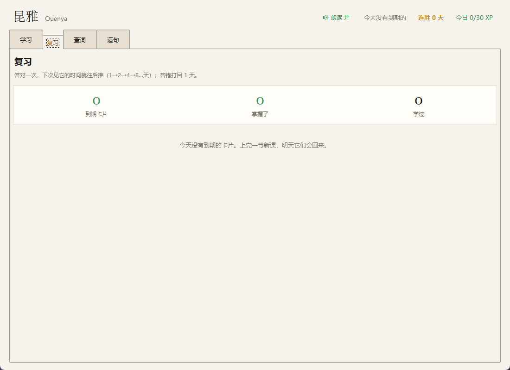
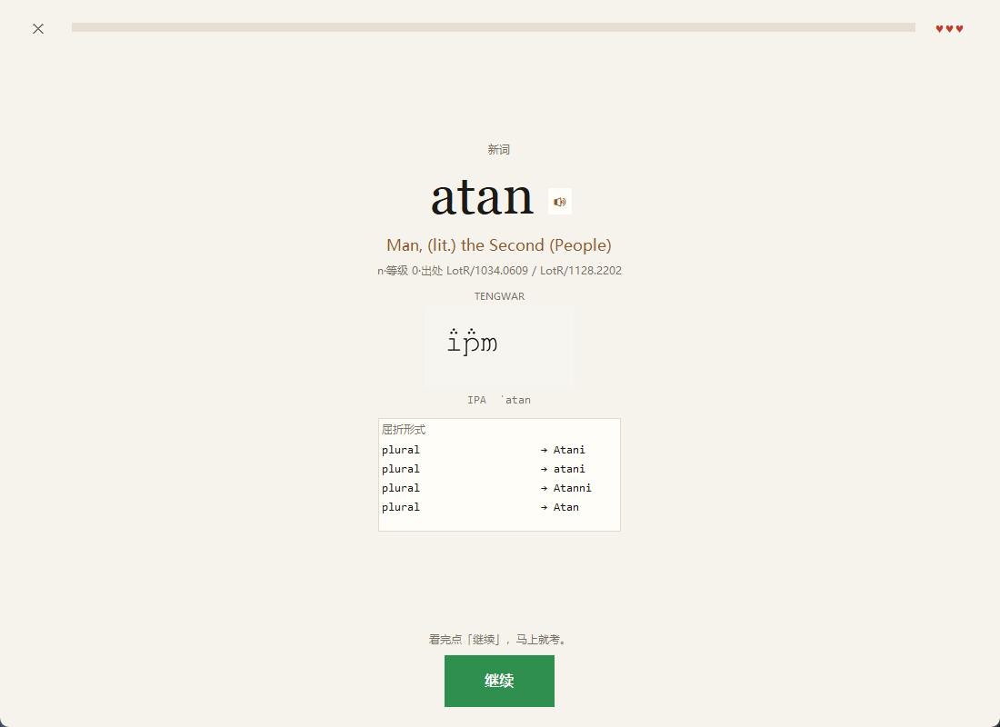
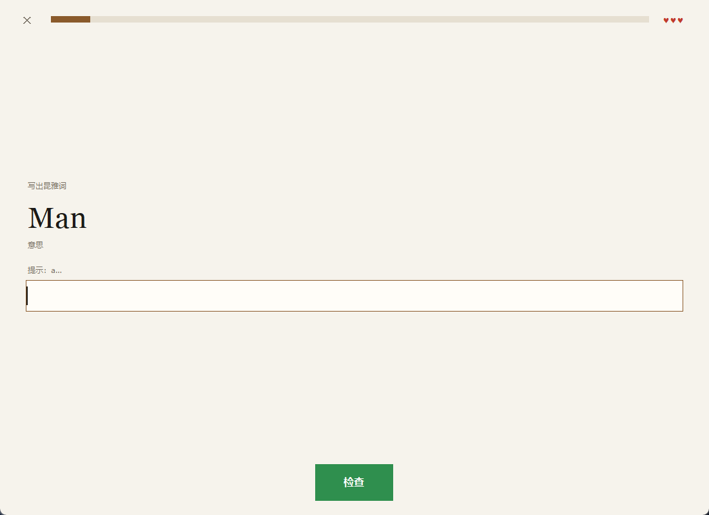
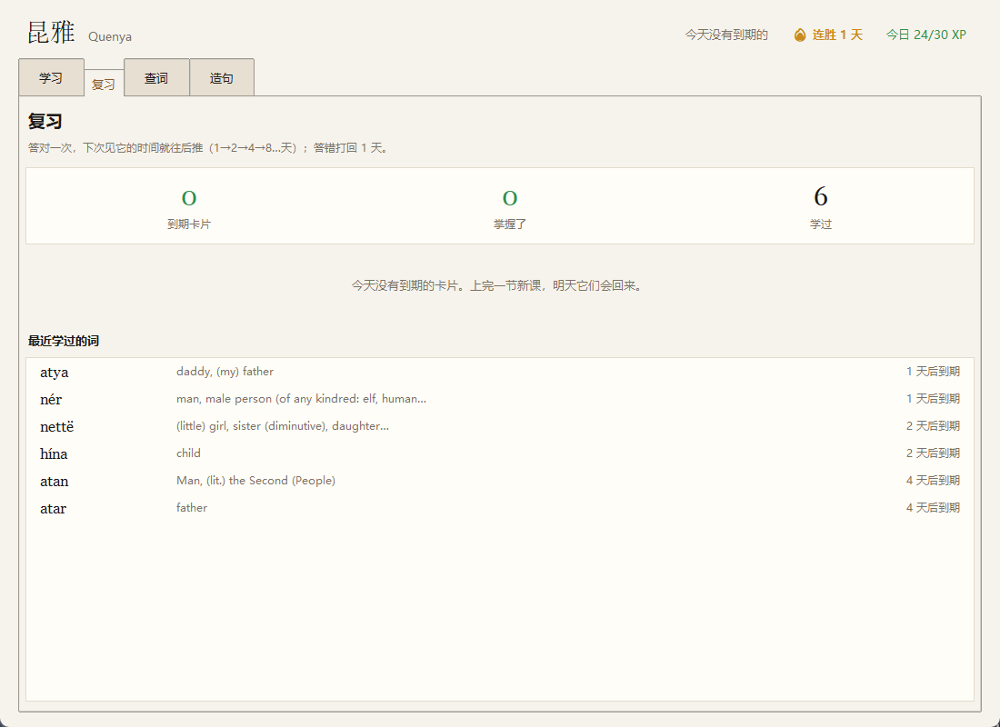
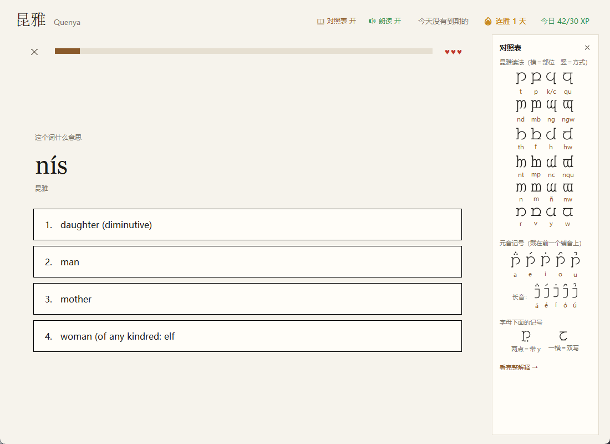
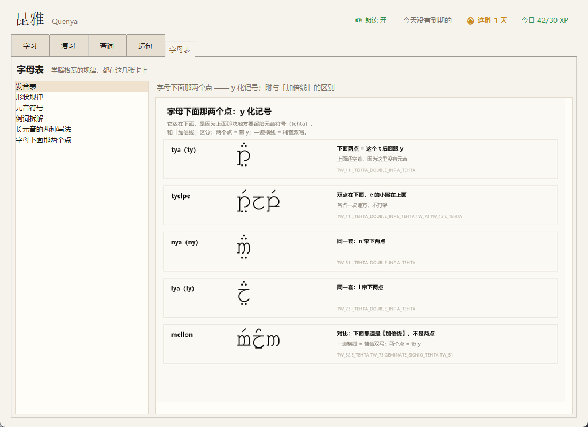
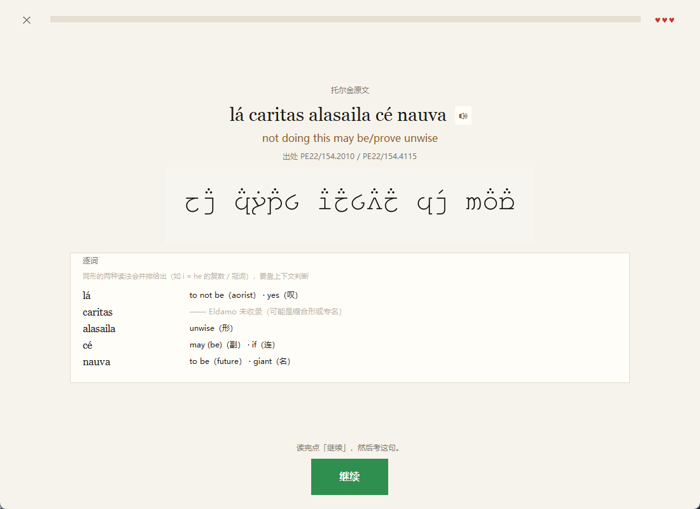
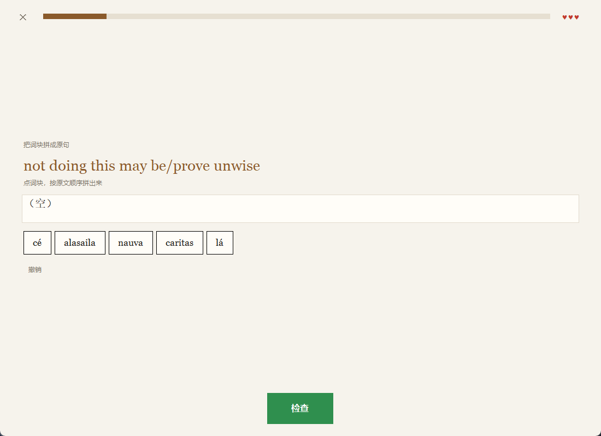
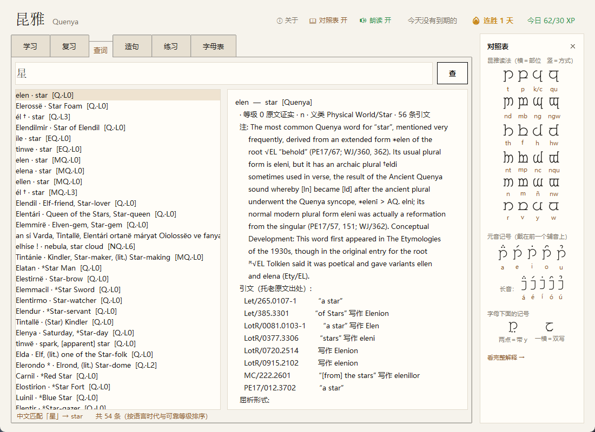

# 昆雅精灵语学习底座（elvish-quenya）

> **v1.0.0** · Windows 桌面应用（源码运行；需要 Python 3.9+ 与 Node 18+）

一个**可查证**的昆雅（Quenya）学习底座：把 Paul Strack 的 [Eldamo](https://eldamo.org) 词库灌进本地 SQLite，
配一个查词/验句工具和一份 DSH 技能，让学精灵语这件事不再靠模型瞎编。

## 从零跑起来

只支持 **Windows**（启动器是 `.vbs`/`.lnk`，语音走 Windows 的 DLL）。三步：

```powershell
# 1) Python 依赖（图形界面用 Pillow；其余都是标准库）
pip install -r requirements.txt   # Pillow（lxml 只在重建词库时用得上）

# 2) 转写引擎（拉丁字母 → 腾格瓦字母）。不装也能用，只是没有精灵文字母图
npm install

# 3) 启动
.\昆雅.cmd
```

然后双击 **`昆雅.vbs`** 就是无黑窗的日常入口（想装桌面快捷方式见下面的「桌面应用」）。

需要 **Python 3.9+**（要带 tkinter，官方安装包默认带）和 **Node.js 18+**（仅转写用）。依赖清单：`requirements.txt`（Python）、`package.json`（Node）。

| 缺什么 | 会怎样 |
|---|---|
| 没 `npm install` | 一切正常，但「读出精灵文字母」那类题会退回成拼写题，词卡上也没有腾格瓦 |
| 没 `pip install Pillow` | 起不来（图形界面与所有图片渲染都依赖它） |
| 没 Node.js | 同「没 npm install」，且 `elvish.py tengwar` 不可用 |

> 语音开箱可用：`assets/espeak/` 里已经带了 `libespeak_ng.dll` 与昆雅音素数据，不需要另外安装。
> 词库 `data/elvish.db` 也已随仓库提供，**不需要**重建；只有你想改词库时才需要下原始 XML。

## 为什么需要它

LLM 讲精灵语时幻觉极高：语法框架编得像模像样，词汇却常有大量不存在的词。精灵语是 conlang，
没有母语者、没有语料可校验，所以唯一可靠的办法是**每个词都能回链到托老原文出处**。

这个底座就干这件事：词库每条都带 `lang`（哪个时期的语言）、`mark`（可靠性标记）、
`ref`（原文引文，如 `LotR/1117.0701`），查的时候直接把证据摆出来。

## 数据

| 项 | 值 |
|---|---|
| 来源 | [Eldamo](https://eldamo.org) v0.8.13（2026-06-01 生成） |
| 作者 / 授权 | © Paul Strack，[CC-BY 4.0](https://creativecommons.org/licenses/by/4.0/)——可自由使用，须署名 |
| 原始文件 | `data/eldamo-data.xml`（28.9 MB）**不随仓库分发**——需要重建词库时跑 `node tools/fetch-eldamo.mjs` 现取 |
| 词库 | `data/elvish.db`（22 MB，35900 词条 / 90852 条引文 / 18154 个屈折形 / 16350 个构词成分） |

**本项目不拥有这些数据**，只是把它整理成可查的形式；分发衍生品请保留上面这段署名。

## Tengwar（精灵文字母）

拉丁转写 → Tengwar，用 [Glǽmscribe](https://github.com/BenTalagan/glaemscribe) 1.3.1（AGPL-3.0 © Benjamin Babut）的
`quenya-tengwar-classical` 模式，输出 CSUR 私有区的 Unicode 码位（U+E0xx）。

```bash
& $PY tools/elvish.py tengwar "Elen síla lúmenn' omentielvo"
& $PY tools/elvish.py tengwar "Nai tiruvantel ar varyuvantel i Valar tielyanna" --png out.png
& $PY tools/elvish.py check "Elen síla lúmenn' omentielvo" --tengwar    # 核对 + 转写一条命令
```

`--png` 会渲染成图片。**为什么能直接画**：FreeMonoTengwar 是等宽字体，元音符号（tehta）的 advance 宽度为 0，
所以「辅音 + 符号」在同一格自然叠合，不需要 GPOS/Graphite 排版引擎 —— 用 Pillow 直接画就对。
反过来说，Chromium 不支持 Graphite，网页里靠浏览器排版反而会掉字距；所以走 CPU 渲染而不是截图。

字体与许可：

| 资源 | 授权 | 用途 |
|---|---|---|
| `assets/tengwar-font/FreeMonoTengwar.2013-07-21/` | GPL + 字体嵌入例外（[Free Tengwar Font Project](https://freetengwar.sourceforge.net/)） | 渲染 Tengwar |
| `assets/freefont/freefont-20120503/FreeSerif.ttf` | GPL + 字体例外（[GNU FreeFont](https://www.gnu.org/software/freefont/)） | 配图上方的拉丁转写 |

两款字体都可再分发，已随包附带各自的 GPL 文本。


### 语言代号

| 代号 | 语言 | 说明 |
|---|---|---|
| `q` | Quenya (Late 1950–1973) | 托老晚年定型的昆雅，**学习主力** |
| `nq` | Neo-Quenya | 后世把各时期混编 + 粉丝补词，现代写作常用 |
| `mq` / `eq` | Middle / Early Quenya | 1930–50 / 1910–30 的昆雅，历史形态 |
| `s` / `ns` | Sindarin / Neo-Sindarin | 辛达林（另一门精灵语，不是昆雅） |
| `p` `mp` `ep` | Primitive Elvish 各期 | 原始精灵语，词根层 |

### 可靠性等级（来自 Eldamo 的标记体系）

| 等级 | 含义 | 标记 |
|---|---|---|
| 0 | 托老原文证实 | 无标记 + 有引文 |
| 1 | 可由原文词按规则推导 / 仅作复合词成分 | `#` |
| 2 | 未直接出现，但可比对同源词合理重建 | `*` |
| 3 | 托老用于古语或诗歌体，现代口语不用 | `†` |
| 4 | 由早期语言版本改写而来 | `^` |
| 5 | 推测性较强 / 托老自己打了问号 | `?` `‽` |
| 6 | 纯新造词（其他作者发明，非托老） | `!` |
| 9 | Eldamo 不建议在新昆雅写作中使用 | `⚠️` |

## 桌面应用

双击项目根目录的 **`昆雅.vbs`**（推荐，不弹黑窗）；如果系统拦脚本，就双击 **`昆雅.cmd`**。

想把它装成正经的桌面应用，双击一次 **`安装快捷方式.cmd`**：

| 装什么 | 装到哪 |
|---|---|
| 桌面快捷方式 | `%USERPROFILE%\Desktop\昆雅.lnk` |
| 开始菜单快捷方式 | 开始菜单里搜「昆雅」就能找到 |
| 开机自启 | `…\Start Menu\Programs\Startup\昆雅.lnk` |

图标是 `assets/quenya.ico`：深色圆角底 + 一枚金色的四角星（**elen** 就是「星」）。
浅色桌面上能跳出来，16px 也认得出。下面是**资源管理器实际画出来的**样子（左浅底、右深底，
左边大图、右边小图）：


图标这里踩过一个坑，值得写下来：**`IconLocation` 里带中文路径时，资源管理器解析不出图标，
会静默退回「未知文件」的白纸图标** —— 表现就是"图标根本看不见"，而且没有任何报错。
所以安装器会先把 ico 复制到 `%LOCALAPPDATA%\QuenyaLearn\quenya.ico`（纯 ASCII），
再让快捷方式引用那里；程序自己设窗口图标时也走同一条路。

另一条是设计上的：旧版是浅色卡片 + 腾格瓦细笔画，缩到 16px 就糊成一团灰。
现在的版本改用**屏幕尺度下还站得住的形状**（实心星），不再依赖细线。

不想开机自启就双击 **`移除快捷方式.cmd`**（三个一起删，随时可以再装）。只想要桌面、不要自启：

```
powershell -NoProfile -ExecutionPolicy Bypass -File tools\install.ps1 -NoAutostart
```

安装脚本只写这三个 `.lnk`，**不改注册表、不要管理员权限**；每条链接写完都会回读校验一遍，
确认指向的确实是 `pythonw.exe` + `app\learn_app.py`，而不是「调用成功就当成功」。

它不是词典浏览器，是一个按**语言学习产品的通行做法**做出来的学习应用：

| 来自哪 | 拿的是什么 | 在这里长成什么样 |
|---|---|---|
| Duolingo | 一节 3 分钟、必须主动产出、答完立刻反馈、错题当堂回来、连胜/XP 驱动每天回来 | 6 词一节课；先看词卡再立刻考；四选一/拼写/读字母三种题型；连击计数；♥♥♥ 三条命 |
| Anki | 间隔重复：答对拉长间隔，答错打回 1 天 | 每张卡独立排期 1→2→4→8→16→32→64 天，复习页只喂到期卡片 |
| 教科书 | 有结构的顺序，而不是随机词袋 | 10 个语义单元 × 3 节，从「人 → 食物 → 自然 → 动物」这种具体词开始，语法虚词留到最后 |
| 只有昆雅能做的 | — | **读出精灵文字母**：给一张 Tengwar 图，从四个词里选一个；每个词卡都带托老原文出处 |






课程内容不是手写的：`app/course.py` 从词库里按「语义大类 + 引文条数」自动生成
——引文多说明托老原文用得多，先学；干扰项从同一义类里挑，所以选项是真的容易混。

进度存在 `data/progress.json`（卡片间隔、每天 XP、连胜、已完成的课），删掉就是重新开始。
`app/course.py` 里 `LADDER = [1,2,4,8,16,32,64]` 就是那张间隔表，想调快调慢改这里。

五个页签：

| 页签 | 能干什么 |
|---|---|
| 学习 | 课程路径：当前该上哪一节、哪节已完成、哪节还没解锁；点进去就上课 |
| 复习 | 到期卡片数、掌握进度、最近学过的词及各自下次到期时间 |
| 查词 | 输入昆雅词或英文反查 → 左侧命中列表（带语言代号与可靠等级 `[Q.·L0]`）→ 右侧完整词条 |
| 造句 | 敲一句昆雅 → 逐词核对 → 同屏转写并渲染 Tengwar |
| 字母表 | 六张图卡讲清腾格瓦的规律：发音表 / 形状规律 / 元音符号 / 例词拆解 / 长元音的两种写法 / 字母下面那两个点 |

**上课时也能开着看。** 右上角「📖 对照表」开一个侧栏：24 个基本字母（字形 + 昆雅读法）、
五个元音记号、长音、以及字母下面那两种记号。侧栏挂在主区外面，所以上课的全屏层不会盖住它。



侧栏里的字形是**单独渲染的小图**，文字用真字体排——不是把整张大图缩小塞进去。
所以窗口缩放、换成 300px 窄栏都清楚。（把 1000px 的图缩到 195px，字会糊成一片。）



字母表的图不是手画的，是 `tools/make_alphabet_cards.py` 调引擎现生成的——
改了字体或转写模式，重跑一次就同步。卡里的每一个字形都来自实际转写结果，不是贴图。

界面不重新实现任何逻辑：查词/验句/转写调用 `tools/` 下已验证的函数，课程与排期在 `app/course.py`。

旧的纯词典版还留着，双击 **`词典.cmd`** 打开。

## 读原文：从背单词到真的能读

课程后面是一整条阅读线，用的全是**托尔金自己写下的句子**——Eldamo 里 `speech='phrase'`
的词条就是「原文里出现过的整句」，每条都带出处（`VT43/08.3800`、`PE22/154.2010`…）。

从 374 条候选里筛掉过长、过短、译文残缺的，剩下 **244 句**，按原文出处分成 **20 章 66 节课**：

| 章节来源 | 例子 |
|---|---|
| Vinyar Tengwar 43 | 昆雅版《主祷文》片段：`Átaremma i ëa han Eä` |
| Parma Eldalamberon 22 / 23 | 托老晚期语法手稿里的例句 |
| The Lost Road | `sinomë maruvan ar Hildinyar tenn' Ambar-metta`（埃西铎的誓言） |
| The Monsters and the Critics | 论稿中的例句 |
| The Lord of the Rings | `elen síla lúmenn' omentielvo` |

阅读线不锁，随时从任意一章读起。



关键在**逐词拆解**：每个词给出释义、语法身份，以及——同形异义时**并排给出两种读法**。
比如 `i` 既能是 he 的复数、也能是冠词，`nauva` 既是「巨人」也是 na- 的将来时。
卡片会写明「要靠上下文判断」，而不是替你选一个。这就是读原文最该长出的肌肉。

读完就考：

| 题型 | 玩法 |
|---|---|
| 句子→意思 | 给原文句子，从四个译文里选（干扰项来自同一章，所以真的得读懂） |
| 词块排序 | 给译文，把打散的词块按原文顺序拼回去 |



## 语音

能。而且不是「凑合能响」——用的是 **espeak-ng 自带的昆雅音素数据**（voice `qya`，列表里叫 Quenya）。

为什么不能用系统 TTS：Windows 上只有英语和中文语音，交给它读昆雅会按英语拼写念错——
长元音 á/é/í/ó/ú 会丢掉，`qu` 会读成 /kwʌ/，`c` 会读成 /s/。昆雅里这些全是区别词义的。

为什么 espeak-ng 行：它带这门语言的音素规则。验证方式是看它输出的 IPA：

| 词 / 句 | espeak 输出的 IPA | 对不对 |
|---|---|---|
| `mellon` | `mˈɛllɔn` | 双写 ll 拉长、ɛ 不是英语的 /ɛə/ |
| `Elen síla` | `ˈɛlɛn sˈiːla` | 长 í = iː，重音各在首音节 |
| `Nai tiruvantel` | `nˈaɪ tˌɪruvˈantɛl` | ai 是双元音，不是 /eɪ/ |

界面上每个词卡都显示 IPA，所以「听到的」和「应该是什么」能对照。

**实现上看不出是个 TTS**：不启动子进程、不装系统语音，直接 ctypes 加载 `libespeak_ng.dll`
（`app/speech.py`）。踩到的坑：espeak 的数据路径里不能有非 ASCII 字符，而本项目就住在「灵感」目录下，
所以首次运行会把数据复制到 `%LOCALAPPDATA%\QuenyaLearn\espeak`（不行就退到临时目录）。

朗读默认开着：词卡、读句卡有 🔊 按钮，答完题自动读一遍正确答案。标题栏可以一键关掉。

## 中文查词

查词框直接打中文就行（自动识别，不必切换模式）：打「星」出 elen，打「剑」出 macil，
打「妈妈」出 amil(lë)。**中文只负责让你找到词条，释义仍以英文原文 + 出处 + 可靠等级为准**。

为什么不用机器翻译：Eldamo 的英文释义用的是古义/诗义，机翻会系统性地翻错——

| 键 | 真实义项 | 机翻常见错误 |
|---|---|---|
| fair | 晴朗、美丽 | 公平 |
| fell | 兽皮 | 落下 |
| spring | 泉、水源 | 春天 |
| light | 光、日光 | 轻的 |

中文检索表是**逐条人工判定**的（`data/zh-keys.json`，现 308 个英文键 / 约 380 个中文词），
优先覆盖课程 180 词的主释义词与高频概念词。没收录就明说，不乱猜：



排序按「主要义项 > 语言时代（晚期昆雅优先）> 可靠等级 > 释义长度」，专名与短语靠后；
英文键按**词边界**匹配（否则 `ear` 会命中 earth / year / heart，实测 826 条）。
匹配结果限定在昆雅系（q/nq/mq/eq），黑语、原始精灵语等不进列表。

要扩表：往 `data/zh-keys.json` 的 `keys` 里加 `"英文键": ["中文", …]`，
`data/zh-keys-candidates.json` 里有按频次排好的候选（前 700 个）。

## 用法（命令行）

```bash
PY="C:\Users\1\.dsh\dsh-runtimes\dsh-primary-runtime\dependencies\python\python.exe"

# 查词（精确 → 前缀 → 包含，按语言时代排序）
& $PY tools/elvish.py word elen

# 英文反查
& $PY tools/elvish.py en "star"

# 按 Eldamo page-id 查
& $PY tools/elvish.py id 3268020261

# 逐词核对一整句昆雅（关键防幻觉工具）
& $PY tools/elvish.py check "Elen síla lúmenn' omentielvo"

# 核对 + 转写成 Tengwar（一条命令走完）
& $PY tools/elvish.py check "Elen síla lúmenn' omentielvo" --tengwar

# 转写并出图
& $PY tools/elvish.py tengwar "mellon" --png m.png

# 今日一词（按日期确定性挑选，可复现）
& $PY tools/elvish.py daily

# 交互模式：敲单词查词，敲整句核对
& $PY tools/elvish.py repl

# 统计
& $PY tools/elvish.py stats
```

嫌 `& $PY` 麻烦就用根目录的 `elvish.cmd elen`（已处理好 UTF-8 输出编码）。

常用选项：`--lang q,nq`、`--tier 0,1`、`--limit 5`、`--brief`、`--png <输出图>`。

## 重建词库

```bash
& $PY tools/build_db.py            # 从 data/eldamo-data.xml 重建 data/elvish.db
& $PY tools/fetch-eldamo.mjs       # 重新下载 XML（需要 node）
```

`fetch-eldamo.mjs` 是并发分块下载器：这台机器单连接只有 ~120 KB/s，28.9 MB 直下要十几分钟。

## 目录

```
elvish-quenya/
├─ 昆雅.vbs               学习应用启动器（推荐，无黑窗）
├─ requirements.txt        Python 依赖（Pillow；lxml 仅重建词库用）\n├─ package.json            Node 依赖（Glǽmscribe，转写用）\n├─ 安装快捷方式.cmd        装桌面/开始菜单/开机自启（双击一次）
├─ 移除快捷方式.cmd        三个一起删
├─ 昆雅.cmd               同上，备用（CRLF + 纯 ASCII）
├─ 词典.cmd               旧版纯词典应用
├─ elvish.cmd             命令行入口（已处理 UTF-8 输出）
├─ app/
│  ├─ learn_app.py        学习应用（学习/复习/查词/造句 + 上课界面）
│  ├─ course.py           课程生成 + 间隔重复排期（无界面）
│  ├─ speech.py           昆雅发音（espeak-ng 的 ctypes 封装，无子进程）
│  └─ quenya_app.py       旧版词典应用
├─ data/
│  ├─ eldamo-data.xml     原始 XML（28.9 MB，可删，删了要重下）
│  ├─ elvish.db           查询用 SQLite（22 MB）
│  ├─ progress.json       学习进度（删掉=重新开始）
│  ├─ tw_cache/           Tengwar 图片缓存
│  ├─ learn-*.png         学习应用截图
│  ├─ app-*.png           词典应用截图
│  ├─ greeting.png        示例：Elen síla lúmenn' omentielvo
│  └─ blessing.png        示例：Nai tiruvantel ar varyuvantel…
├─ tools/
│  ├─ fetch-eldamo.mjs    并发分块下载器（Eldamo XML）
│  ├─ build_db.py         XML → SQLite
│  ├─ elvish.py           查词 / 验句 / 转写 CLI（主入口）
│  ├─ tengwar.mjs         拉丁 → Tengwar 码位（Glǽmscribe 引擎）
│  ├─ install.ps1         快捷方式安装/移除（UTF-8 **带 BOM**，PS 5.1 需要）
│  ├─ make_icon.py        生成 assets/quenya.ico（BMP 帧，小尺寸单独调粗）
│  ├─ make_alphabet_cards.py  生成「字母表」页的五张图卡
│  └─ render_tengwar.py   码位 → PNG（Pillow + FreeMonoTengwar）
├─ assets/
│  ├─ tengwar-font/       FreeMonoTengwar.ttf + GPL
│  ├─ freefont/           FreeSerif.ttf（配图拉丁字）+ GPL
│  ├─ espeak/             libespeak_ng.dll + 昆雅音素数据（23 MB，GPLv3）
│  ├─ quenya.ico          应用图标（深底 + 金色四角星，elen）
│  ├─ alphabet/           「字母表」页的图卡（01-grid … 06-palatal）
│  └─ NOTICE.txt          以上所有第三方资源的许可与来源
├─ node_modules/          glaemscribe（AGPL-3.0）
└─ README.md
```

## 许可

本项目**自己的代码**（`app/`、`tools/`、`mobile/` 里非 vendor 的部分、各启动脚本）以 **AGPL-3.0** 发布，全文见 [LICENSE](LICENSE)。

选 AGPL 是因为包里确实带着几个第三方作品，它们的许可各自继续有效，**不会因为本项目整体是 AGPL 就被替换**：

| 内容 | 位置 | 许可 | 出处 |
|---|---|---|---|
| Glǽmscribe 转写引擎 | `mobile/web/vendor/glaemscribe.min.js`、`node_modules/glaemscribe` | AGPL-3.0 | © Benjamin Babut，未改动 |
| FreeMonoTengwar / FreeSerif | `assets/tengwar-font/`、`assets/freefont/`、`mobile/web/fonts/` | GPL + 字体嵌入例外 | Free Tengwar Font Project / GNU FreeFont |
| espeak-ng | `assets/espeak/`（`libespeak_ng.dll` + 语音数据） | GPL-3.0 | espeak-ng 1.52.0 |
| Eldamo 词库与原文引文 | `data/eldamo-data.xml`、`data/elvish.db` | CC-BY-4.0 | © Paul Strack，**须署名** |
| 昆雅原文例句 | 词库里 `speech='phrase'` 的条目 | 逐条标注出处 | The Tolkien Estate |

完整清单与来源见 [assets/NOTICE.txt](assets/NOTICE.txt)；分发衍生品时请把上面这张表和第三方许可文本一起带上。CC-BY 的词库只要求署名，不做「再许可」。

> **AGPL §13**：这个项目有公开在线版本（[your-site.netlify.app](https://your-site.netlify.app)），通过网络使用它的人有权拿到对应源码 —— 本仓库就是那份源码。

## 许可与署名

本仓库是几份不同授权的东西拼起来的，逐项写在 **[THIRD-PARTY.md](THIRD-PARTY.md)** 里（谁的作品、什么版本、有没有改、源码去哪拿）。

| 部分 | 许可 |
|---|---|
| 本仓库代码 | [AGPL-3.0](LICENSE) |
| Eldamo 词库（© Paul Strack） | [CC-BY 4.0](LICENSES/CC-BY-4.0.txt) |
| Glǽmscribe（转写引擎） | AGPL-3.0（由 npm 安装，不含在本仓库） |
| eSpeak NG（发音） | [GPL-3.0](LICENSES/GPL-3.0.txt) |
| FreeMonoTengwar / FreeSerif | GPL + 字体嵌入例外 |
| 根目录 | `LICENSES/` 放 GPL-3.0 与 CC-BY-4.0 全文，`assets/NOTICE.txt` 是来源与授权摘要 |

**关于托尔金**：昆雅语、腾格瓦字母及相关名称的权利属于 Tolkien Estate 与 Middle-earth Enterprises 等权利人，
不在上面任何开源许可的授权范围内。本仓库仅作语言学习用途引用词语与出处，不包含《魔戒》等作品正文、
影视素材或官方标识，也不声称获得授权。这是一个**同人、非官方、免费**项目。
## 还没做的

- **发音**：昆雅的长短元音与重音有明确规则，但"标准音"是重构的，没有母语者可对照。
  真要听，只能用系统 TTS 念拉丁转写，读不出昆雅的长短对立。
- **语法讲义**：课程顺序对应 Eldamo 官方 15 章入门课，但还没有成文的语法讲义页面。
- **辛达林**：词库和转写模式都已具备（`--mode sindarin-tengwar-beleriand`），但没有单独的课程骨架。

